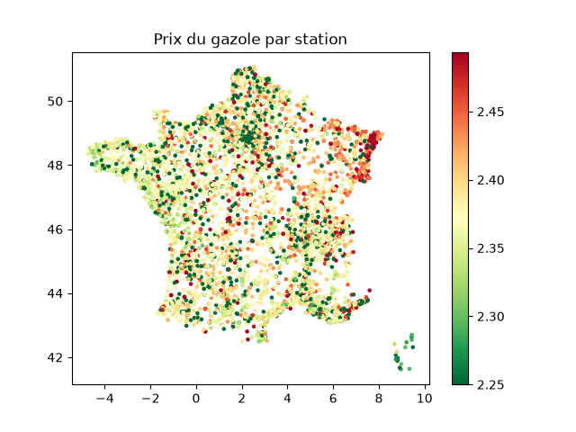

# Where and when to buy fuel at the best price?

A personal project to learn how to build an end-to end data pipeline: every hour, I collect the prices of the ~9,800 French fuel stations from the government API, clean them, store them in a SQLite database, and analyze them.

## What I found

How much can you save on a 50 L diesel fill-up?

1. **Choosing the right department → up to ~€10.75 saved**
   The cheapest department is about 21 cts/L cheaper than the most expensive one.
2. **Avoiding the highway → ~€4.70 saved**
   Highway stations are about 9.4 cts/L more expensive than those on regular roads.
3. **Picking the right time of day → less than €0.50 saved**
   Prices vary by less than 1 ct/L over the day.
4. **Picking the right day of the week → ~€0.15 saved**
   Prices vary by only ~0.3 ct/L from one day to another.

**In short: where you fill up matters far more than when.** No need to wait for a specific day or time. Avoiding highways and picking a cheaper area saves much more.

- **The North-East is the most expensive** (Bas-Rhin, Haut-Rhin, Moselle), **Corsica and the West are the cheapest** (Vendée, Finistère, Eure-et-Loir). The ranking holds even after removing highway stations.
- **E10 is about 10 cts/L cheaper than SP98.** E85 is around €0.90/L, but engines burn 20 to 30% more of it and it requires a compatible vehicle.



## How it works

**data.economie.gouv.fr API → extract.py → raw JSON → transform.py → SQLite → analyse.py**

- **Extract**: fetches all stations in batches of 100 (pagination) and saves a timestamped raw JSON. If the API returns an error, the run is cancelled so no incomplete data gets loaded.
- **Transform**: cleans the latest JSON and appends it to the database. A collection that is already stored is never added twice.
- **Automation**: a `.bat` script run every hour by the Windows Task Scheduler, with a log file.

## Cleaning choices

- Removed redundant columns (JSON stored as text, badly formatted coordinates).
- Converted dates to UTC and extracted latitude / longitude.
- **Dropped prices older than 7 days**: 75% of prices are less than 6 days old, and a price that hasn't changed in a week may no longer be accurate. Age is computed from the collection time, not the cleaning time.
- Checked extreme prices with the interquartile method: no obvious errors, so nothing was removed.
- Raw JSON files are kept so everything can be reprocessed if needed.

## Running the project

```bash
python -m venv venv
venv\Scripts\activate
python -m pip install -r requirements.txt

python src/extract.py
python src/transform.py
python src/analyse.py
```

To automate it, update the path in `run_pipeline.bat`, then:

```bash
schtasks /create /tn "PipelineCarburants" /tr "C:\path\to\run_pipeline.bat" /sc hourly
```

## Structure

```
src/        extract.py, transform.py, analyse.py
data/       raw JSON, SQLite database, log (not versioned)
images/     charts
```

## Limitations

- Collections only run when my PC is on and connected, so there are gaps, especially at night and early in the morning.
- About a week and a half of data: too short to separate a day-of-week effect from a general price trend.

## Stack

Python, requests, pandas, NumPy, matplotlib, SQLite, Git.
